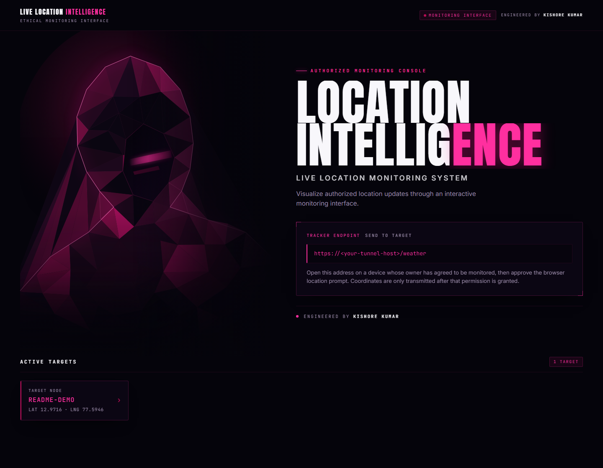
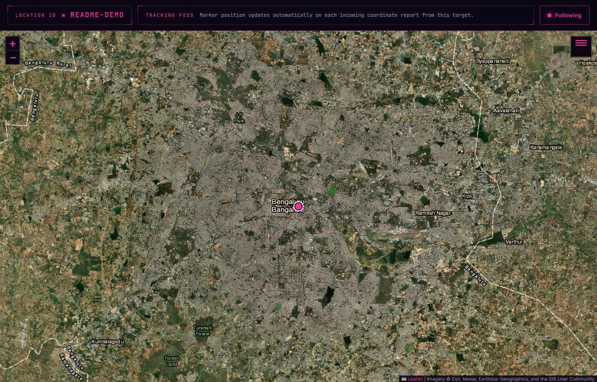
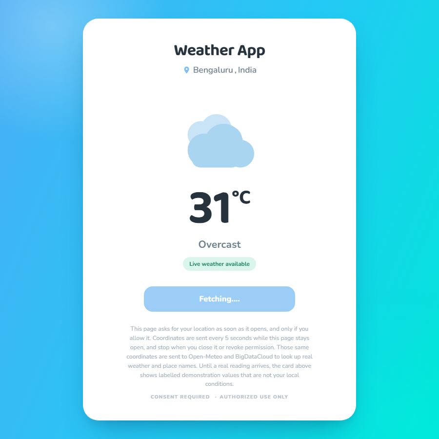

<<<<<<< HEAD
<p align="center">
  
</p>

<p align="center">
  <strong>Real-Time Location Visualization &amp; Authorized Monitoring</strong><br>
  <em>Live Location Tracking System — designed and developed by Kishore Kumar</em>
</p>

<p align="center">
  <a href="#features"></a>
  <a href="#live-demo"></a>
  
  
</p>

<p align="center">
  <a href="#privacy-and-security"></a>
  <a href="#limitations"></a>
</p>

---

> [!IMPORTANT]
> **This is a consent-based monitoring tool for devices you own or are explicitly authorized to track.**
> Every location report on this project starts with the browser's own permission prompt on the target device. Nothing here bypasses that prompt, and there is no covert, hidden or background mode. Using it on a device whose owner has not consented may be illegal — check your local law before you deploy it anywhere.

---

## Table of Contents

1. [Features](#features)
2. [Technology Stack](#technology-stack)
3. [Live Demo](#live-demo)
4. [Project Overview](#project-overview)
5. [Application Workflow](#application-workflow)
6. [Screenshots](#screenshots)
7. [Project Structure](#project-structure)
8. [Installation](#installation)
9. [Configuration](#configuration)
10. [Usage](#usage)
11. [Privacy and Security](#privacy-and-security)
12. [Limitations](#limitations)
13. [Troubleshooting](#troubleshooting)
14. [Contributing](#contributing)
15. [License](#license)
16. [Credits](#credits)

---

## Features

Everything in this table was verified against the source in this repository. The **Status** column distinguishes what ships today from what is only scaffolding.

### Implemented

| # | Capability | Where it lives | Status |
|---|------------|----------------|--------|
| 1 | **Cookie session gate** — `/` and `/map` redirect to `/login` until a valid `token` cookie is presented; `/login` and `/weather` stay open so a target device can report in | `router.js` → `checkToken` | Implemented |
| 2 | **Monitoring dashboard** — server-rendered target list (ID + `LAT`/`LNG`), live-appended over the socket, with an honest `0 TARGETS` empty state | `views/home.html`, `#tar-content` | Implemented |
| 3 | **Tracker endpoint** — a share page that asks the browser for a position and reports it back | `views/weather.html` → `POST /weather` | Implemented |
| 4 | **Location ID management** — 10-character alphanumeric ID generated client-side, cached in `localStorage`, reused across visits | `views/weather.html` → `generateId()` | Implemented |
| 5 | **Real-time update channel** — Socket.IO pushes `user-connected` and `map-data` to the dashboard and map; no page reload needed | `router.js`, `server.js` | Implemented |
| 6 | **Interactive Leaflet map** — pan, zoom (max 19), layer control, and a single pulsing marker that follows the target | `views/map.html` | Implemented |
| 7 | **Satellite basemap + label overlay** — Esri World Imagery with Esri place/border labels, switchable to OpenStreetMap street tiles | `public/config.js` → `map.satellite` / `map.street` | Implemented |
| 8 | **Follow / release control** — auto-follow centres the map on each update; a manual drag releases it without stopping tracking | `views/map.html` → `#follow-toggle` | Implemented |
| 9 | **Marker popups** — show the target ID and the coordinates currently held by the server | `views/map.html` → `popupHtml()` | Implemented |
| 10 | **Weather card** — server-rendered placeholder values paint instantly, then real conditions, place names and a condition icon replace them | `views/weather.html`, `public/weather.css` | Implemented |
| 11 | **Cinematic design system** — particle / streak / glitch layers, pointer parallax, staggered entrances, all disabled under `prefers-reduced-motion` | `public/magenta.css`, `public/magenta-ui.js` | Implemented |
| 12 | **Responsive layout** — the dashboard, terminal, map chrome and weather card all adapt down to phone widths | `public/magenta.css`, `public/weather.css` | Implemented |

### Optional / configurable

| Capability | Notes |
|------------|-------|
| **Cloudflare Quick Tunnel** | Enabled on every boot because it is wired into `server.js`. There is no flag to turn it off — see [Limitations](#limitations). |
| **Swap the basemap provider** | Every tile URL, attribution and label flag is overridable by environment variable, so a keyed provider (MapTiler, Thunderforest, self-hosted tiles) can replace Esri/OpenStreetMap without touching source. See [Configuration](#configuration). |
| **Disabling the weather lookup** | Remove the two `fetch` calls in `refresh()` in `views/weather.html`; the card then stays on its labelled placeholder values indefinitely and nothing else changes. |
| **Street-tile fallback on failure** | After five failed satellite tile requests the map surfaces a notice with a one-tap switch to the street layer. |

### Planned / not implemented

- No persistent database — every coordinate lives in process memory and is gone after a restart.
- No user accounts, roles or per-target access control. One shared credential protects the whole dashboard.
- No history, trails or geofencing. You see the latest position only.
- No clustering or multi-target map view. The map is scoped to one `?id=` at a time.
- No automated test suite in CI. Two local harnesses exist (`regression.js`, `visual-test.js`) but they are temporary developer tools, not a maintained test suite.

---

## Technology Stack

Only what this repository actually uses.

**Runtime and server**

| | |
|---|---|
|  | Server runtime ([nodejs.org](https://nodejs.org)) |
|  | HTTP routing and static file serving ([expressjs.com](https://expressjs.com)) |
|  | Reads the `token` session cookie |
|  | Server push of `user-connected` / `map-data` ([socket.io](https://socket.io)) |
|  | Provisions the public tunnel at boot |
|  | The template engine used to render `views/*.html` ([npm registry](https://registry.npmjs.org/tarkine)) |

**Frontend**

| | |
|---|---|
|  | Interactive map ([leafletjs.com](https://leafletjs.com)) — CSS and JS are loaded from unpkg at runtime |
|  | Browser client, loaded from jsDelivr at runtime |
|  | No framework, no bundler, no build step |
|  | Hand-authored design system, no CSS framework |

**External services** (all keyless, all called from the browser)

| | |
|---|---|
|  | Satellite basemap tiles — an ArcGIS Online Map Service ([esri.com](https://www.esri.com/en-us/arcgis/products/arcgis-online)) |
|  | Street basemap tiles ([openstreetmap.org/copyright](https://www.openstreetmap.org/copyright)) |
|  | Temperature and WMO weather code |
|  | City and country names from coordinates |

**Typography** — Anton, Inter and JetBrains Mono, loaded from Google Fonts. The terminal, dashboard and map share them.

> The app ships no `.env` loader, no test framework, no linter config and no CI workflow. `package.json` declares exactly five runtime dependencies.

---

## Live Demo

<div align="center">

| | |
|---|---|
|  |  |

</div>

**There is no permanent public deployment of this project, and this README does not link to one.** None exists in the repository, and inventing a URL would send you to somebody else's machine.

What actually happens on boot:

1. `server.js` starts Express on port `6589`.
2. It calls `cloudflaredTunnel()` from the `cloudflared` package, which requests a **Cloudflare Quick Tunnel**.
3. Cloudflare returns a random `*.trycloudflare.com` address, which is printed to the console and injected into the dashboard as the tracker endpoint.

That address is **ephemeral by design**. It is different on every single run, it exists only while your Node process is alive, and Cloudflare may reclaim it at any time. Treat it as a temporary demo link, not a deployment.

### Running it locally

```bash
npm install
npm start
```

Then open:

| Route | Purpose | Auth required |
|-------|---------|---------------|
| `http://localhost:5000/login` | Secure access terminal | — |
| `http://localhost:5000/` | Monitoring dashboard | Yes — `token` cookie |
| `http://localhost:5000/map?id=<ID>` | Live map for one target | Yes — `token` cookie |
| `http://localhost:5000/weather` | Tracker / weather share page | — |

The console prints both the local and the tunnel URL:

```text
LOCAL  : http://localhost:5000
REMOTE : https://<something>.trycloudflare.com
```

> **Why geolocation works on `localhost`:** browsers only expose the Geolocation API in a *secure context*. `http://localhost` counts as one, so the tracker page works locally with no certificate. The Cloudflare tunnel is HTTPS, so it works on a phone over the tunnel too. Serving this app from a plain-HTTP IP address or a bare domain will **not** expose geolocation.

---

## Project Overview

**Live Location Intelligence** is a self-hosted Node/Express application that shows where a consenting device is, in real time, on a cinematic dark interface.

It has three moving parts and no database:

- **A share page** (`/weather`) that asks the browser for a position and posts it back every five seconds.
- **A server** that keeps the latest coordinate for each device ID in memory and broadcasts every change over a WebSocket.
- **A dashboard and map** (`/`, `/map`) that you authenticate into and read that feed from.

A device gets a random ID the first time it visits the share page and keeps it in `localStorage`. The server holds a single `TARGETS` object mapping that ID to `[lat, lng]`. Each report overwrites the previous one and emits a `map-data` event; the map marker and popup move to match.

The whole interface — magenta rim-lit faceted artwork, drifting particles, staggered entrances, HUD chrome — is presentation only. It lives entirely in `public/magenta.css` and `public/magenta-ui.js`, and every animation is switched off when the visitor's system asks for reduced motion.

**Design language.** The hero figure is not stock art. `tools/generate-figure.js` builds `public/assets/figure.svg` from scratch: a hand-authored hooded silhouette, a Delaunay mesh over its interior, and a harsh side-on lighting model that leaves the body near-black and ignites only the rim. The generator is seeded, so running it again reproduces the identical file.

---

## Application Workflow

<div align="center">

| 1 | 2 | 3 | 4 | 5 | 6 | 7 |
|---|---|---|---|---|---|---|
| **Start** | **Authenticate** | **Read the endpoint** | **Open it on a device** | **Grant permission** | **Watch it arrive** | **Open the map** |
| `npm start` | `POST /login` | copy from `/` | visit `/weather` | browser prompt | every 5s | `/map?id=…` |

</div>

### Step by step

1. **Start the application.** `npm start` boots the server and opens a Cloudflare Quick Tunnel.
2. **Open the login route.** Go to `http://localhost:6589/login` and authenticate with the credentials from `config.js`. A `token` cookie is set and you are redirected to `/`. *(A failed attempt also redirects — the guard on `/` simply bounces you back to `/login`.)*
3. **Read the tracker endpoint.** The dashboard shows `<tunnel-url>/weather` under **Tracker Endpoint**.
4. **Open that address on a device whose owner has agreed to be monitored.** The share page paints immediately with clearly labelled demonstration values, so it is never a blank screen.
5. **Allow the browser's location permission when prompted.** Nothing is transmitted until this is granted. If permission is refused, the page keeps its labelled placeholders, explains why, and stops re-prompting.
6. **Watch the position arrive.** The page stores the device ID in `localStorage` and `POST`s `{ id, lat, lng }` to `/weather`, then repeats every five seconds while the tab stays open. Each report emits `user-connected` the first time and `map-data` every time.
7. **Follow it on the dashboard and map.** New IDs appear in the Active Targets list without a reload. Opening a target navigates to `/map?id=<ID>`, where the marker, popup and (while following is on) the map centre jump to each new coordinate.
8. **Optional: the weather card.** Alongside the tracker POST, the page looks up current conditions and a place name for those coordinates and replaces its placeholders. This is a convenience layer — it is entirely separate from the location-reporting path and removing it changes nothing about tracking.

### Route reference

| Method | Path | Auth | Purpose |
|--------|------|------|---------|
| `GET` | `/login` | No | Renders the access terminal |
| `POST` | `/login` | No | Compares credentials, sets the `token` cookie, redirects to `/` |
| `GET` | `/weather` | No | Renders the tracker / weather share page |
| `POST` | `/weather` | No | Stores `[lat, lng]` for `id`, emits `user-connected` (first time) and `map-data`, replies `OK` |
| `GET` | `/` | Yes | Monitoring dashboard; renders `TARGETS` |
| `GET` | `/map?id=<ID>` | Yes | Map for one target; receives `data` and `mapCfg` |

Everything after `checkToken` in `router.js` requires the cookie, which is why the two "No" rows above are the only open endpoints.

---

## Screenshots

All four images below were captured from a running instance of this repository. The dashboard capture has its ephemeral tunnel address replaced with a placeholder.

### Dashboard — target list and tracker endpoint

<p align="center">
  
</p>

### Map — Esri satellite imagery with the tracked marker

<p align="center">
  
</p>

<p align="center">
  <sub>Satellite view is <strong>static orthophoto imagery</strong> served as map tiles — not a live video feed. The marker is the only live element.</sub>
</p>

### Weather — live conditions for the shared coordinates

<p align="center">
  
</p>

### Terminal — secure access gate

<p align="center">
  
</p>

---

## Project Structure

Generated from the real working tree. `node_modules/` and `package-lock.json` are git-ignored and omitted.

```text
live-location-tracker/
│
├── server.js                  Entry point. Express + Socket.IO + cookie-parser,
│                              tarkine view engine, static /public, and the
│                              Cloudflare Quick Tunnel started on listen().
│
├── router.js                  Every route. Holds the in-memory TARGETS map,
│                              the checkToken cookie guard, and the two
│                              socket emits (user-connected, map-data).
│
├── config.js                  Port, credentials, session token, and the
│                              satellite/street basemap configuration.
│                              Basemap values can be overridden by env vars.
│
├── package.json               Five runtime deps, `start` and `dev` scripts.
│
├── views/                     Tarkine templates, rendered server-side.
│   ├── login.html             Access terminal. POSTs to /login.
│   ├── home.html              Dashboard. Iterates TARGETS; consumes
│   │                          user-connected over Socket.IO.
│   ├── map.html               Leaflet map for ?id=. Reads basemap settings
│   │                          from the #map-config dataset, not from a
│   │                          <script> block, because the template engine
│   │                          escapes interpolated values.
│   └── weather.html           Tracker + weather share page. Geolocation,
│                              location ID generation, the 5s POST loop and
│                              the weather lookup all live in its inline
│                              script.
│
├── public/                    Served verbatim by express.static.
│   ├── assets/
│   │   └── figure.svg         The hooded-figure hero artwork. Generated,
│   │                          animated (CSS sparks + breathing halo).
│   ├── magenta.css            Dark magenta design system: tokens, HUD
│   │                          panels, motion layers, reduced-motion guards.
│   ├── magenta-ui.js          Presentation only — particles, streaks,
│   │                          glitch, wireframe, pointer parallax, and the
│   │                          live target counter. No network or auth logic.
│   ├── weather.css            Blue-to-cyan card design for /weather.
│   ├── weather.png            Default weather illustration.
│   ├── wx-*.svg               Seven condition illustrations (clear, partly
│   │                          cloudy, overcast, fog, rain, snow, thunder)
│   │                          selected from the WMO weather code.
│   ├── cinematic.css          Legacy stylesheet, not referenced by any view.
│   └── cinematic-ui.js        Legacy script, not referenced by any view.
│
├── tools/
│   └── generate-figure.js     Seeded generator for figure.svg. Re-run with
│                              `node tools/generate-figure.js` to reproduce
│                              the exact same artwork.
│
├── docs/
│   └── assets/                README assets.
│       ├── banner.svg         Animated hero banner (CSS particles, scan
│       │                      line and the real figure, all self-contained
│       │                      SVG — GitHub renders animated SVG via ).
│       ├── dashboard.png      Dashboard capture.
│       ├── map.jpg            Map capture.
│       ├── weather.png        Weather card capture.
│       └── login.png          Terminal capture.
│
├── shots/                     Raw captures from the local visual harness.
│
├── regression.js              TEMPORARY local harness: renders every template
│                              through tarkine and asserts that the required
│                              markup and application calls survive. Marked
│                              for deletion after a run.
│
├── visual-test.js             TEMPORARY local harness: drives real Chrome over
│                              CDP against a live server. Marked for deletion
│                              after a run.
│
└── README.md
```

> `cinematic.css` and `cinematic-ui.js` are leftovers from an earlier design pass. Nothing links to them today; they are kept only so the earlier work is not lost. Deleting them is safe.

---

## Installation

### Prerequisites

- **Node.js v16 or newer.** `package.json` does not declare an `engines` field, so nothing enforces this; development and testing were done on Node 24.
- **npm**, bundled with Node.
- **A browser with the Geolocation API** — any current Chrome, Edge, Firefox or Safari. Note that iOS Safari and some Android browsers disable geolocation outside a secure context.
- **Outbound internet access**, because the server opens a Cloudflare tunnel at boot and the browser fetches Leaflet, the Socket.IO client and Google Fonts from CDNs. See [Troubleshooting](#troubleshooting) for running without it.

### 1. Clone

```bash
git clone https://github.com/madhanmaaz/live-location-tracker.git
cd live-location-tracker
```

### 2. Install dependencies

```bash
npm install
```

This pulls five runtime packages: `express`, `socket.io`, `cookie-parser`, `tarkine` and `cloudflared`.

### 3. Configure credentials

Open `config.js` and replace the development defaults before you expose this to anything but `localhost`:

```js
module.exports = {
    port: 6589,
    username: "<your username>",    // ← replace the shipped default
    password: "<your password>",    // ← replace the shipped default
    token: "<a long random string>", // ← replace the shipped default
    map: { satellite, street }
}
```

> **The values that ship in this repository are development placeholders and are public.** Read `config.js` to see them, and replace all three before the server is reachable by anything other than yourself.

The shipped `token` is a static string compared with `===` on every guarded request. It is **not** a session: nothing is stored server-side, the cookie is only given a long `maxAge` (about three years, set in `router.js`) and is never invalidated, and anyone who obtains the value is an administrator.

### 4. Start

```bash
npm start
```

```
LOCAL  : http://localhost:6589
REMOTE : https://<random>.trycloudflare.com
```

For auto-restart while editing, the repository also defines a `dev` script — but **`nodemon` is not listed in `dependencies`**, so install it yourself first:

```bash
npm install --save-dev nodemon
npm run dev
```

### 5. Sign in and try it

1. Open `http://localhost:6589/login`.
2. Sign in with your `config.js` credentials.
3. Copy the **Tracker Endpoint** from the dashboard.
4. Open that URL in a **second** browser (a private window works well) and allow the location prompt.

The dashboard fills in on its own — no refresh needed.

---

## Configuration

`config.js` is the single configuration file. There is **no `.env` file and no dotenv loader** in this project; the only environment variables it reads are listed below.

### `config.js`

| Key | Default | Purpose |
|-----|---------|---------|
| `port` | `6589` | HTTP listen port. `process.env.PORT` overrides it in `server.js`. |
| `username` | `admin` | Login user. **Change before any real use.** |
| `password` | `admin` | Login password. **Change before any real use.** |
| `token` | 40-char hex string | Value stored in the session cookie and compared on guarded routes. **Change before any real use.** |
| `map.satellite` | Esri World Imagery | Satellite basemap definition |
| `map.street` | OpenStreetMap | Street basemap definition |

### Basemap environment overrides

Every satellite and street field can be overridden without editing a source file — useful for swapping in a keyed provider such as MapTiler or Thunderforest, or your own tile server.

| Variable | Overrides |
|----------|-----------|
| `SATELLITE_TILE_URL` | `map.satellite.url` |
| `SATELLITE_LABELS_URL` | `map.satellite.labelsUrl` |
| `SATELLITE_ATTRIBUTION` | `map.satellite.attribution` |
| `SATELLITE_LABELS` | `map.satellite.labels` — set to `false` to drop the place-name overlay |
| `STREET_TILE_URL` | `map.street.url` |
| `STREET_ATTRIBUTION` | `map.street.attribution` |
| `PORT` | The HTTP listen port |

Example — point the satellite layer at a self-hosted tile server and turn off the label overlay:

```bash
SATELLITE_TILE_URL="https://tiles.example.com/sat/{z}/{y}/{x}.png" \
SATELLITE_LABELS="false" \
STREET_ATTRIBUTION="© Your Tile Provider" \
npm start
```

Keys are never written into `views/*.html`. `config.js` states this explicitly: pass them through the provider's own URL mechanism.

### Template engine

Views are rendered by **tarkine**, not by a more familiar engine. The directives in use are:

| Directive | Meaning |
|-----------|---------|
| `{{ expression }}` | Interpolate a value |
| `{{ if (condition) }} … {{ else }} … {{/}}` | Conditional block |
| `{{ for (value, key in object) }} … {{/}}` | Loop over the object |
| `{{~ const name = … }}` | Evaluate a statement and bind a local |

Because interpolated values are HTML-escaped, `map.html` reads its basemap settings through the `#map-config` element's `dataset` rather than embedding them inside a `<script>` block, where escaped quotes would break the JavaScript.

---

## Usage

### As the operator

1. Sign in at `/login`.
2. Leave the dashboard open in a tab. New targets appear as they report in.
3. Click a target to open its map.
4. Use the layer switcher (top-right) to toggle between satellite and street imagery.
5. Use **Following** to keep the map centred on the device. Panning manually releases the follow; tracking continues either way.

### As the tracked device owner

1. Open `<tunnel-url>/weather`.
2. Read the notice — the page says up front that it asks for your location on open and that it sends coordinates every five seconds while the tab is open.
3. Allow or refuse the permission prompt. Either way the page stays usable: refusal keeps the labelled demonstration weather and tells you so.
4. Close the tab, or revoke the permission in the browser, to stop sharing.

### Managing sessions

- **Stop one session:** close the tab or revoke location permission. The device's last position stays visible on the dashboard until another target overwrites that entry — it is not removed automatically.
- **Stop everything:** stop the Node process. All coordinates are discarded.
- **Change who can sign in:** edit `username`, `password` and `token` in `config.js` and restart.

---

## Privacy and Security

### What this project actually does

- **It asks, and it waits.** Coordinates leave the device only after the browser's own permission prompt is accepted. There is no code path that bypasses, suppresses or auto-grants that prompt.
- **It runs on the target device.** Tracking starts from `/weather` opened on the phone or laptop you have permission to monitor — there is no agent to install and no remote command channel.
- **Sharing is bounded.** The loop stops when the tab is closed. On refusal it stops immediately and is never re-prompted.
- **It discloses its third parties.** When live weather is shown, the same coordinates are sent to Open-Meteo and BigDataCloud, and the page footer says so in plain words.
- **Placeholders are labelled.** The weather card's initial values are placeholders, marked `Demo Weather`, and they are never presented as real observations.

### What this project does **not** do

Be clear-eyed about the gaps — this is teaching and demonstration software, not a hardened product:

- **No transport encryption of its own.** It serves plain HTTP. Confidentiality depends entirely on the tunnel in front of it.
- **No database, no audit trail.** State is in-process memory; there is no history, no export, no deletion-on-request.
- **No rate limiting, no CSRF protection, and no authentication on `POST /weather`.** That endpoint is open by design so a device can report in without an account — which also means anyone who can reach the server can write a position into the `TARGETS` map or overwrite an existing entry. Do not expose it to an untrusted network.
- **One shared credential for the entire dashboard.** There are no per-user accounts, roles or per-target scoping, and the cookie value is static and can only be invalidated by restarting with a different `token`.
- **Credentials are hard-coded in `config.js` and are committed to the repository**, where they are publicly readable. The shipped pair is a well-known placeholder — see `config.js`. **Change all three values before putting this anywhere public.**
- **Coordinates leave your process memory.** They sit in a plain object in `server.js` process space, and the same values are handed to two external geocoding/weather providers.

### Responsible use

- Only track devices and accounts you own or have explicit, informed permission to monitor. Consent from the person holding the device — not from the person who happens to know the URL.
- Do not use this for covert surveillance, stalking, or any purpose where the device owner does not know they are being tracked.
- Check your local law. In many jurisdictions, tracking a person without their knowledge or consent is a criminal offence regardless of the technical method.
- Prefer a tunnel you control over a random Quick Tunnel for anything beyond a demo.
- Set up a retention policy for your own deployments. This project has none.

### Third-party terms

Map tiles are served by **Esri** and **OpenStreetMap**, and both carry their own usage policies and attribution requirements — the project renders Esri's attribution string and OpenStreetMap's copyright notice in the map control. Weather and place names come from **Open-Meteo** and **BigDataCloud**. Review each provider's terms before pointing real traffic at them.

---

## Limitations

| # | Limitation | Why it matters |
|---|------------|----------------|
| 1 | **Ephemeral tunnel, always on** | The Cloudflare Quick Tunnel is started unconditionally in `server.js`; there is no flag to skip it, so the server needs outbound internet even when you only want `localhost`. |
| 2 | **No persistence** | `TARGETS` lives in `router.js` module scope. A restart erases every coordinate and every target. |
| 3 | **Latest position only** | Each report overwrites the last. There is no trail, history or playback. |
| 4 | **Five-second granularity** | The share page posts once every five seconds. This is not sub-second, and movement between reports is invisible. |
| 5 | **Single-target map** | `/map` renders one `?id=`. There is no multi-target view and no clustering. |
| 6 | **One shared credential** | No per-user identity, roles or per-target access control. |
| 7 | **Unauthenticated ingest** | `POST /weather` requires no token by design, so it is also writable by anyone who can reach the server. |
| 8 | **Static satellite imagery** | Esri World Imagery is orthophoto mosaic, not a live video feed. The map can look "frozen" while the marker moves. |
| 9 | **CDN dependencies** | Leaflet, the Socket.IO client and the fonts are fetched from unpkg, jsDelivr and Google Fonts at runtime. Offline or restricted networks get a broken page. |
| 10 | **Weather is an optional extra** | The weather lookup needs outbound internet from the browser. When it fails, the card keeps its placeholders and says so — tracking is unaffected. |
| 11 | **Pinned socket client, unpinned Leaflet** | `socket.io@4.8.1` is pinned; `leaflet` is loaded without a version, so a future upstream release could change behaviour without a commit here. |
| 12 | **No maintained test suite** | `regression.js` and `visual-test.js` are temporary local harnesses, both headed "deleted after the run". There is no CI. |

---

## Troubleshooting

<details>
<summary><b>Server starts but nothing loads at <code>/</code></b></summary>

You are probably not signed in. `router.js` puts a `checkToken` guard in front of `/` and `/map`, so an unauthenticated request is redirected to `/login`. Sign in with your `config.js` credentials and retry.
</details>

<details>
<summary><b><code>GeolocationPositionError: Permission denied</code> on the share page</b></summary>

The browser prompt was declined, dismissed, or is blocked for this origin. The page handles this: it keeps its labelled demonstration values, shows an amber notice, re-enables the button and stops re-prompting. To share, open the browser's site settings for that origin, allow location, then tap **Check Weather**.

Also confirm you are on a **secure context**. `http://localhost` qualifies; a plain-HTTP LAN IP such as `http://192.168.1.5:6589` does not, and `navigator.geolocation` will be undefined or will fail.
</details>

<details>
<summary><b>Coordinates never reach the dashboard</b></summary>

Work through this list:

1. **Tab left open?** The loop stops when the tab closes or the page is backgrounded-throttled.
2. **Permission actually granted?** Check the padlock / site-settings icon in the address bar.
3. **Both apps on the same origin?** The share page posts to a relative `/weather`, so it must be opened on the same server you are watching.
4. **Device ID collision?** The ID lives in `localStorage` per browser per origin. A private window gets a fresh one, which is fine — it just becomes a separate target.
5. **Watch the server console.** Every accepted report prints `> <id> - [lat,lng]`. Silence there means the request never arrived.
</details>

<details>
<summary><b>Map shows grey tiles or the satellite notice appears</b></summary>

The tile provider could not be reached. The map switches to a notice after five failed tile requests, with a one-tap **Street Map** fallback. Esri's imagery service is public but does rate-limit; if you need steady traffic, point `SATELLITE_TILE_URL` at your own provider.
</details>

<details>
<summary><b><code>npm start</code> hangs on <code>REMOTE :</code></b></summary>

The server is waiting on `cloudflaredTunnel()` to provision the tunnel, and that needs outbound network. If you are offline or firewalled, this line will never resolve. `server.js` has no offline mode; see [Limitations](#limitations). Until it resolves the dashboard still works locally — it falls back to `http://localhost:6589` and the `/` route and `/map` are reachable directly.
</details>

<details>
<summary><b>Page loads but the map and fonts are missing</b></summary>

Leaflet and the Socket.IO client load from unpkg and jsDelivr, and the fonts from Google Fonts. An offline or restricted network breaks all three. Self-host the assets by downloading them into `public/` and changing the `<link>` / `<script>` tags in `views/map.html` and the font `<link>` tags.
</details>

<details>
<summary><b><code>npm run dev</code> fails with "nodemon: not found"</b></summary>

Expected — `nodemon` is referenced by the `dev` script but is not in `dependencies`. Install it first:

```bash
npm install --save-dev nodemon
```
</details>

<details>
<summary><b>Weather card stays on the demonstration values</b></summary>

Either the location lookup failed (no permission, insecure context), or the browser could not reach Open-Meteo / BigDataCloud. Check the status pill: an amber badge names which of those happened. The tracking POST runs independently, so coordinates still reach the dashboard even when the weather lookup fails.
</details>

<details>
<summary><b>Regenerate the hero artwork</b></summary>

```bash
node tools/generate-figure.js
```

The generator is seeded, so this reproduces `public/assets/figure.svg` byte-for-byte unless you change the seed.
</details>

---

## Contributing

Contributions are welcome, with two ground rules that are not negotiable.

**The rules**

1. **Consent stays explicit.** No change may introduce a tracking path that skips the browser's permission prompt, silently start on load without disclosure, or conceal that coordinates are being sent.
2. **Placeholder data stays labelled.** Anything synthetic must be visibly marked as such and must never be presented as a real observation.

**Getting set up**

```bash
git clone https://github.com/<your-fork>/live-location-tracker.git
cd live-location-tracker
npm install
npm start
```

**Before you open a pull request**

- Confirm `node regression.js` still passes — it asserts that the required markup, DOM ids, template directives and application calls survive template rendering.
- If you touched the UI, run `node visual-test.js` (needs Chrome on Windows at the path the harness expects, plus network access for the tunnel and the CDN assets).
- Keep the three concerns separated: routes and socket events in `router.js`, presentation in `public/`, and behaviour in the template's script. The existing codebase is strict about this and reviewers will hold you to it.
- Prefer small, focused pull requests. Do not mix a redesign with a backend change.

**Good first issues**

- An environment flag to skip the Cloudflare tunnel so the app can run fully offline.
- Optional persistence behind an interface, so `TARGETS` is not welded to process memory.
- A multi-target map view.
- Self-hosted map assets, so the app no longer depends on three CDNs at runtime.

---

## License

`package.json` declares **ISC**.

> [!NOTE]
> **No `LICENSE` file exists in this repository yet.** The `ISC` declaration in `package.json` is the only statement of terms, and it does not include the standard ISC copyright notice. Add a `LICENSE` file with the correct year and copyright holder before you publish or redistribute this.

The artwork is original and generated from scratch by `tools/generate-figure.js`; no third-party image or stock asset is included, and no watermark is present. Map tiles are the property of Esri and OpenStreetMap contributors and are fetched at runtime, not redistributed here.

---

## Credits

**Designed and developed by Kishore Kumar.**

Built on [Express](https://expressjs.com), [Socket.IO](https://socket.io), [Leaflet](https://leafletjs.com), the [tarkine](https://registry.npmjs.org/tarkine) template engine and the [cloudflared](https://developers.cloudflare.com/cloudflare-one/connections/connect-networks/) tunnel client. Basemap imagery courtesy of [Esri](https://www.esri.com/en-us/arcgis/products/arcgis-online) World Imagery and [OpenStreetMap](https://www.openstreetmap.org/copyright) contributors. Weather from [Open-Meteo](https://open-meteo.com), place names from [BigDataCloud](https://www.bigdatacloud.com).

<p align="center">
  
</p>
=======
## Live Location Tracker ##
>>>>>>> origin/main
